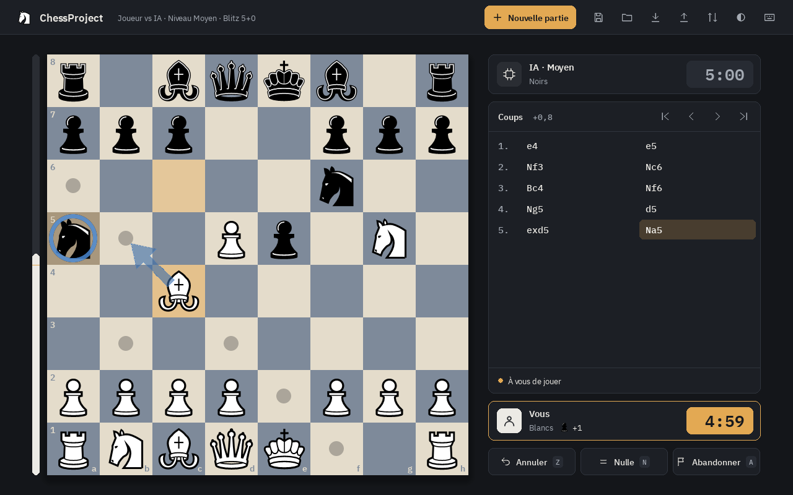

# ChessProject


Jeu d'échecs en Python / Pygame avec une IA NegaMax. Projet personnel servant de vitrine
technique : l'accent est mis sur la justesse des règles, les tests et la qualité du code.

## Fonctionnalités

- **Règles complètes** : roque, prise en passant, promotion et sous-promotions, mat et pat,
  50 coups, triple répétition, matériel insuffisant. Générateur de coups validé par perft
  et par 1 000 parties comparées coup par coup à python-chess.
- **Trois modes de jeu** : Joueur contre Joueur, Joueur contre IA (choix de la couleur),
  IA contre IA.
- **IA** : NegaMax alpha-bêta, approfondissement itératif limité en temps, table de
  transposition (Zobrist), quiescence, évaluation par phase de jeu. Cinq niveaux, de
  Débutant à Expert, dans un processus séparé pour que l'interface reste réactive.
- **Cadences** : Bullet 1+0, Blitz 3+2 et 5+0, Rapide 10+5 et 15+10, ou sans limite.
  Incrément Fischer, perte au temps (nulle si l'adversaire n'a pas de quoi mater). L'IA
  gère son temps.
- **Fin de partie** : abandon, proposition de nulle (l'IA accepte selon son évaluation),
  motif de fin affiché.
- **PGN** : export et import (commentaires, variantes et NAG ignorés à la lecture).
  **Sauvegarde** JSON versionnée, avec mode, niveau et pendules.
- **Protocole UCI** (`chessproject-uci`) : le moteur se branche dans une interface
  d'échecs ou joue contre d'autres moteurs.
- **Interface** : écran « Nouvelle partie » unique (mode, couleur, niveau, cadence),
  thèmes sombre et clair, 4 échiquiers, pièces vectorielles nettes à toutes les tailles,
  fenêtre redimensionnable. Glisser-déposer ou clic-clic, coups possibles affichés,
  flèches et marques au clic droit, historique SAN cliquable pour revoir la partie,
  matériel pris, barre d'évaluation (désactivable), pendule du camp au trait mise en
  avant, carte de fin de partie. Les préférences sont mémorisées.

L'état du projet, les bugs suivis et la feuille de route sont dans
[RAPPORT_ANALYSE.md](RAPPORT_ANALYSE.md).

## Prérequis

- Python **3.12** ou plus récent.
- Dépendances (installées automatiquement) : `pygame` 2.6.1, `platformdirs`.

## Installation

```bash
# Avec les outils de développement (tests, lint, typage)
python -m pip install -e ".[dev]"

# Ou pour jouer uniquement
python -m pip install -e .
```

## Lancement

```bash
chessproject            # commande installée par pip
python -m chessproject  # équivalent
```

Le jeu peut être lancé depuis n'importe quel dossier. La sauvegarde (`saved_game.json`),
les préférences (`settings.json`) et le journal (`chess.log`, tournant) sont écrits dans le dossier de données de
l'utilisateur (par exemple `~/.local/share/ChessProject` sous Linux), modifiable avec la
variable d'environnement `CHESSPROJECT_DATA_DIR`.

### Souris

- **Jouer un coup** : glisser la pièce, ou cliquer la pièce puis la case d'arrivée.
- **Clic droit** : glisser pour tracer une flèche, cliquer pour marquer une case. Un clic
  gauche sur l'échiquier les efface.
- **Historique** : cliquer un coup pour revoir la position. L'échiquier est alors en
  lecture seule ; un clic dessus ramène à la partie.

### Raccourcis clavier

| Touche | Action |
|---|---|
| `Z` | Annuler le dernier coup (contre l'IA, annule aussi la réponse de l'IA) |
| `R` | Rejouer avec les mêmes réglages (confirmation si une partie est en cours) |
| `S` / `L` | Sauvegarder / charger la partie |
| `E` / `I` | Exporter / importer la partie en PGN |
| `A` | Abandonner (avec confirmation) |
| `N` | Proposer la nulle (en Joueur contre Joueur, l'adversaire accepte avec `N`) |
| `F` | Retourner l'échiquier |
| `C` | Apparence : thème, échiquier, aides visuelles, sons |
| `H` | Afficher les raccourcis |
| `←` / `→` | Coup précédent / suivant dans l'historique |
| `Origine` / `Fin` | Position de départ / position actuelle |
| `Échap` | Annuler la sélection, effacer les flèches, fermer une fenêtre |

Pendant une promotion : `D`, `T`, `F`, `C` (ou `Q`, `R`, `B`, `N`) choisissent la pièce.

## Qualité

```bash
python -m pytest -q            # suite rapide (les tests « slow » sont exclus par défaut)
python -m pytest -q -m slow    # perft profond (plusieurs minutes)
ruff check .                   # lint
ruff format --check .          # formatage
python -m mypy .               # typage (strict sur le moteur, souple sur l'UI)
```

Le générateur de coups est validé par un **perft** sur 6 positions de référence (position
initiale, Kiwipete et positions 3 à 6 du Chess Programming Wiki) : le nombre de nœuds de
l'arbre des coups légaux est comparé aux valeurs publiées. Le détail des tests est dans
[TESTS.md](TESTS.md).

## Structure du dépôt

Architecture en couches : `core` ← `ai` ← `ui` (le cœur ne dépend pas de pygame).

| Chemin | Rôle |
|---|---|
| `chessproject/core/engine.py` | Moteur de règles : plateau, génération des coups légaux, annulation, fins de partie (`GameResult`) |
| `chessproject/core/fen.py` | Lecture validée des positions FEN |
| `chessproject/core/notation.py` | Notation SAN et UCI (lecture et écriture) |
| `chessproject/core/perft.py` | Comptage perft, validation du générateur de coups |
| `chessproject/ai/search.py` | IA : NegaMax alpha-bêta, table de transposition, évaluation en centipions |
| `chessproject/serialization.py` | Sauvegarde / chargement JSON versionné, export FEN |
| `chessproject/paths.py` | Chemins des ressources et des données utilisateur |
| `chessproject/settings.py` | Préférences de l'interface, lues et écrites de façon tolérante |
| `chessproject/ui/app.py` | Scènes (`App`), contrôleur de partie, point d'entrée |
| `chessproject/ui/layout.py` | Mise en page adaptative (fonction pure de la taille de fenêtre) |
| `chessproject/ui/theme.py` | Couleurs des thèmes et des échiquiers, polices |
| `chessproject/ui/board_view.py` | Rendu de l'échiquier, pièces SVG, animation, flèches |
| `chessproject/ui/panel.py` | En-tête et panneau latéral (joueurs, pendules, historique) |
| `chessproject/ui/overlays.py` | Fenêtres superposées : raccourcis, apparence, confirmation, fin de partie, promotion |
| `chessproject/ui/new_game.py` | Écran « Nouvelle partie » |
| `chessproject/ui/widgets.py` | Texte, formes, icônes vectorielles, boutons |
| `chessproject/assets/` | Pièces, polices et effets sonores |
| `tests/` | Tests : perft, différentiels contre python-chess, règles, IA, notation, FEN, UI |
| `pyproject.toml` | Métadonnées, dépendances, configuration de ruff, mypy et pytest |
| `RAPPORT_ANALYSE.md` | Audit du projet, suivi des bugs et feuille de route |

## Feuille de route

- **J0 — Outillage** ✅ : `pyproject.toml`, ruff, mypy, CI multi-OS, README.
- **J1 — Correction** ✅ : plus aucun bug bloquant connu (règles, IA, contrôleur).
- **J2 — Socle moteur** ✅ : types, modèle de résultat de partie, notation SAN, FEN validée.
- **J3 — IA** ✅ : adversaire solide, borné en temps, avec niveaux de difficulté.
- **J4 — Fonctionnalités** ✅ : import/export PGN, cadence (temps + incrément), sauvegarde v2.
- **J5 — Interface** ✅ : scènes, thèmes, mise en page adaptative, glisser-déposer,
  historique navigable.
- **J6 — Packaging et vitrine** : exécutables, README illustré, version publiée.

Le détail des tâches et des critères d'acceptation est dans
[RAPPORT_ANALYSE.md, §4](RAPPORT_ANALYSE.md#4-phase-4--feuille-de-route-2026-10-22).

## Captures d'écran




## Licence et crédits

Code sous licence [MIT](LICENSE). Ressources tierces livrées avec le jeu :

- Pièces **Chessnut**, par Alexis Luengas, sous licence Apache 2.0
  ([texte](chessproject/assets/pieces/LICENSE.txt)).
- Polices **IBM Plex Sans** et **IBM Plex Mono**, par IBM, sous licence SIL Open Font
  License 1.1 ([texte](chessproject/assets/fonts/OFL.txt)).
