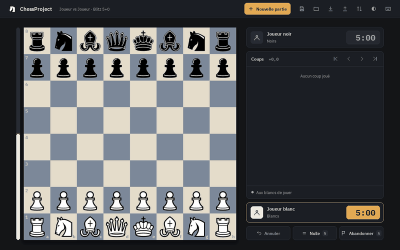
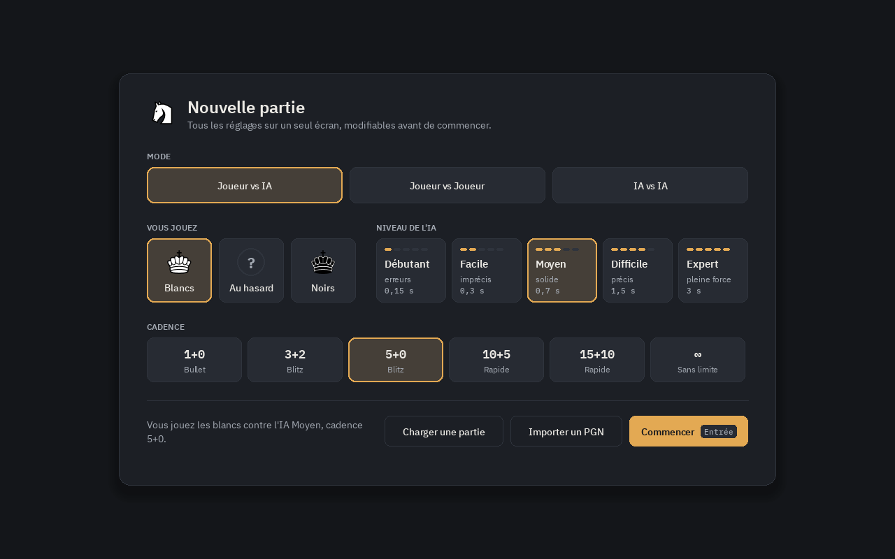
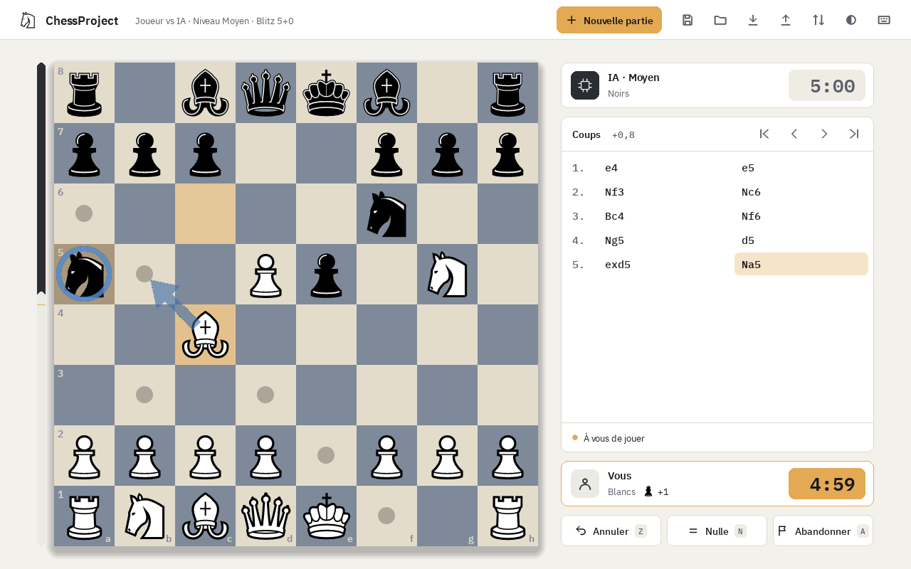
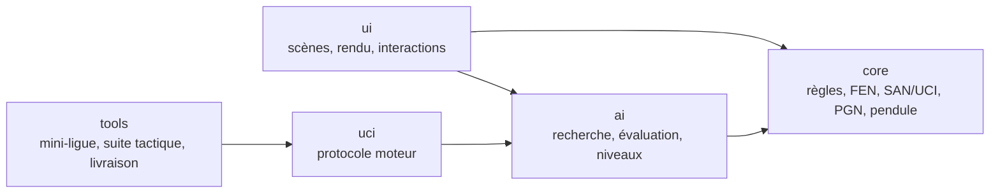

# ChessProject


Jeu d'échecs complet en Python / Pygame, avec une IA à cinq niveaux. Projet personnel
servant de vitrine technique : règles vérifiées contre une référence, moteur mesuré en
Elo, interface soignée, plus de 500 tests.



## Télécharger

Les exécutables de la [dernière version](https://github.com/brybry-dev/ChessProject/releases/latest)
se lancent sans installer Python :

| Système | Archive | Lancement |
|---|---|---|
| Windows 10/11 (x64) | `ChessProject-<version>-windows-x64.zip` | Décompresser, lancer `ChessProject.exe`. L'exécutable n'est pas signé : SmartScreen demande de confirmer (« Informations complémentaires », puis « Exécuter quand même »). |
| macOS (Apple Silicon) | `ChessProject-<version>-macos-arm64.zip` | Décompresser, puis clic droit sur `ChessProject.app` > « Ouvrir » la première fois (application non notariée). |
| Linux (x64, glibc 2.35 ou plus) | `ChessProject-<version>-linux-x64.zip` | Décompresser, lancer `ChessProject/ChessProject`. |

Ou depuis les sources, avec Python 3.12 ou plus récent :

```bash
pipx install git+https://github.com/brybry-dev/ChessProject.git
chessproject
```

## Fonctionnalités

- **Règles complètes** : roque, prise en passant, promotion et sous-promotions, mat et pat,
  50 coups, triple répétition, matériel insuffisant. Générateur de coups validé par perft
  et par 1 000 parties comparées coup par coup à python-chess.
- **Trois modes de jeu** : Joueur contre Joueur, Joueur contre IA (choix de la couleur),
  IA contre IA.
- **IA** : NegaMax alpha-bêta, approfondissement itératif limité en temps, table de
  transposition (Zobrist), quiescence, évaluation par phase de jeu. Cinq niveaux, de
  Débutant (≈ 1250 Elo) à Expert (≈ 1950 Elo), mesurés contre Stockfish bridé, dans un
  processus séparé pour que l'interface reste réactive. **Livre d'ouvertures** de 342
  lignes : l'IA varie ses débuts, et le nom de l'ouverture s'affiche pendant la partie.
- **Cadences** : Bullet 1+0, Blitz 3+2 et 5+0, Rapide 10+5 et 15+10, ou sans limite.
  Incrément Fischer, perte au temps (nulle si l'adversaire n'a pas de quoi mater). L'IA
  gère son temps.
- **Fin de partie** : abandon, proposition de nulle (l'IA accepte selon son évaluation),
  motif de fin affiché.
- **PGN** : export et import (commentaires, variantes et NAG ignorés à la lecture), dans
  le dossier de son choix ; un PGN de plusieurs parties propose la liste des parties.
  **Sauvegardes** JSON versionnées, autant qu'on veut, chacune avec son nom, son mode,
  son niveau et ses pendules.
- **Protocole UCI** (`chessproject-uci`) : le moteur se branche dans une interface
  d'échecs ou joue contre d'autres moteurs.
- **Interface** : écran « Nouvelle partie » unique (mode, couleur, niveau, cadence),
  thèmes sombre et clair, 4 échiquiers, pièces vectorielles nettes à toutes les tailles,
  fenêtre redimensionnable. Glisser-déposer ou clic-clic, coups possibles affichés,
  flèches et marques au clic droit, historique SAN cliquable pour revoir la partie,
  matériel pris, barre d'évaluation (désactivable), variante principale du moteur pour la
  position affichée (mode analyse, touche `V`), indice du meilleur coup en flèche
  (touche `B`, désactivable contre l'IA), bilan de la partie avec courbe d'évaluation
  et imprécisions, erreurs et gaffes de chaque camp (touche `G`), pendule du camp au trait mise en avant,
  carte de fin de partie. Coups jouables au clavier (`Entrée`, puis `e4`, `Nf3`, `O-O`…).
  **Français ou anglais**, au choix. Tout se fait aussi au clavier : fenêtres (`Tab`),
  échiquier (curseur de case). Contrastes vérifiés au niveau WCAG AA
  (`tools/contrast.py`). Les préférences sont mémorisées.

| Écran « Nouvelle partie » | Thème clair |
|---|---|
|  |  |

## Jouer

### Souris

- **Jouer un coup** : glisser la pièce, ou cliquer la pièce puis la case d'arrivée.
- **Clic droit** : glisser pour tracer une flèche, cliquer pour marquer une case. Un clic
  gauche sur l'échiquier les efface.
- **Historique** : cliquer un coup pour revoir la position. L'échiquier est alors en
  lecture seule ; un clic dessus ramène à la partie.

### Clavier

- **Jouer un coup** : `Entrée` (ou `Espace`), taper le coup, puis `Entrée`. La saisie est
  tolérante : `e4`, `Nf3` ou `nf3`, `Nxe5` ou `Ne5`, `O-O` ou `0-0`, `e8=Q` ou `e8Q`,
  coordonnées `e2e4`, et les initiales françaises (`Cf3`, `Fc4`, `Dh5`, `Td1`, `Re2`).
  Sans pièce de promotion (`e8`), le choix s'ouvre. Un coup illégal, ambigu ou illisible
  est signalé et reste à corriger ; `Échap` ferme la saisie.
- **Ou au curseur, sans notation** : `K` affiche un curseur de case, les flèches le
  déplacent, `Entrée` (ou `Espace`) prend la pièce puis la pose. `Échap` repose la pièce,
  puis quitte le mode « échiquier » (les flèches parcourent de nouveau l'historique).
- **Fenêtres et écran « Nouvelle partie »** : `Tab` / `Maj+Tab` passent d'un bouton à
  l'autre, `Entrée` ou `Espace` activent celui qui a le focus.

### Raccourcis clavier

| Touche | Action |
|---|---|
| `Z` | Annuler le dernier coup (contre l'IA, annule aussi la réponse de l'IA) |
| `R` | Rejouer avec les mêmes réglages (confirmation si une partie est en cours) |
| `Entrée` / `Espace` | Taper un coup (cf. ci-dessus) |
| `K` | Curseur de case sur l'échiquier (flèches, `Entrée`) |
| `S` / `L` | Sauvegarder sous un nom / choisir la sauvegarde à charger (`Suppr` pour en supprimer une) |
| `E` / `I` | Exporter / importer la partie en PGN, dans le dossier choisi |
| `A` | Abandonner (avec confirmation) |
| `N` | Proposer la nulle (en Joueur contre Joueur, l'adversaire accepte avec `N`) |
| `F` | Retourner l'échiquier |
| `C` | Apparence : thème, langue, échiquier, aides visuelles, sons |
| `V` | Afficher ou masquer la variante principale (mode analyse) |
| `B` | Indice : le meilleur coup s'affiche en flèche (option « Indices contre l'IA » dans Apparence) |
| `G` | Bilan de la partie : courbe d'évaluation (cliquer pour voir une position), imprécisions `?!`, erreurs `?` et gaffes `??`, aussi marquées dans l'historique |
| `H` | Afficher les raccourcis |
| `←` / `→` | Coup précédent / suivant dans l'historique |
| `Origine` / `Fin` | Position de départ / position actuelle |
| `Échap` | Annuler la sélection, effacer les flèches, fermer une fenêtre |
| `Tab` / `Maj+Tab` | Dans une fenêtre : bouton suivant / précédent (`Entrée` ou `Espace` pour l'activer) |

Pendant une promotion : `D`, `T`, `F`, `C` (ou `Q`, `R`, `B`, `N`) choisissent la pièce,
ou les flèches puis `Entrée`.

## Choix techniques



Les dépendances vont toujours vers `core`, qui ne connaît ni pygame ni l'IA : les règles
se testent sans écran, et le même moteur sert le jeu, le protocole UCI et les outils.

- **Règles prouvées, pas seulement testées.** Le générateur de coups est validé par
  **perft** (nombre exact de positions à profondeur *n*) sur 6 positions de référence, et
  par des **tests différentiels** : 1 000 parties aléatoires comparées coup par coup à
  python-chess. C'est ainsi qu'a été trouvé un pion cloué qui pouvait avancer vers son
  roi (B46).
- **IA mesurée en Elo.** Chaque amélioration passe par une mini-ligue (`tools/match.py`)
  avec intervalle de confiance : +545 Elo pour la recherche (table de transposition
  Zobrist, approfondissement itératif, quiescence), +112 Elo à temps égal pour
  l'évaluation par phase de jeu. Les cinq niveaux sont calibrés sur une échelle
  (`tools/calibrate.py`) et ancrés contre Stockfish 19 bridé ; leur force repose sur un
  budget de nœuds, la même sur toutes les machines.
- **Temps maîtrisé.** L'IA tourne dans un processus séparé (l'interface reste fluide).
  Son budget de réflexion suit sa pendule, moins un surcoût **mesuré** en jeu (lancement
  du processus, échéance) : aucune perte au temps en 1+0.
- **Interface sans boucle bloquante.** Une seule boucle et des scènes ; l'animation est
  calculée à chaque image ; une fenêtre modale suspend la pendule et l'IA. La mise en
  page est une fonction pure de la taille de fenêtre, testée sans affichage.
- **Données robustes.** Sauvegarde versionnée à écriture atomique, préférences lues champ
  par champ, PGN importés en règles FIDE strictes pour accepter les vraies parties.
- **Livraison automatisée.** À chaque tag, la CI construit les exécutables des trois
  systèmes et les lance en mode test de démarrage (une partie contre l'IA) avant de les
  publier.

L'audit, les bugs suivis (B26–B46) et les mesures sont dans
[RAPPORT_ANALYSE.md](RAPPORT_ANALYSE.md) ; l'historique des versions dans
[CHANGELOG.md](CHANGELOG.md).

## Développement

```bash
python -m pip install -e ".[dev]"   # jeu + tests, lint, typage
chessproject                        # ou : python -m chessproject
chessproject-uci                    # moteur UCI, pour une interface d'échecs
```

La sauvegarde (`saved_game.json`), les préférences (`settings.json`) et le journal
(`chess.log`, tournant) sont écrits dans le dossier de données de l'utilisateur (par
exemple `~/.local/share/ChessProject` sous Linux), modifiable avec la variable
d'environnement `CHESSPROJECT_DATA_DIR`.

```bash
python -m pytest -q            # suite rapide (~30 s ; les tests « slow » sont exclus)
python -m pytest -q -m slow    # perft profond, 1 000 parties différentielles (~4 min)
python -m pytest -q --cov --cov-report=json && python tools/coverage_report.py coverage.json
ruff check . && ruff format --check .
python -m mypy .               # strict sur le moteur, l'IA et les données
```

Le détail des tests est dans [TESTS.md](TESTS.md).

### Construire un exécutable

```bash
python -m pip install -e ".[build]"
python tools/build_exe.py --smoke-test   # -> dist/ChessProject-<version>-<système>.zip
```

### Publier une version

Mettre à jour la version (`pyproject.toml`, `chessproject/__init__.py`) et
`CHANGELOG.md`, puis pousser un tag `v<version>` : le workflow
[`release.yml`](.github/workflows/release.yml) construit, teste et publie. Sans
possibilité de pousser un tag : onglet Actions, workflow « Release », « Run workflow »
sur `master` avec « publier » coché (le tag est alors créé par le workflow).

## Structure du dépôt

| Chemin | Rôle |
|---|---|
| `chessproject/core/engine.py` | Moteur de règles : plateau, génération des coups légaux, annulation, fins de partie (`GameResult`) |
| `chessproject/core/fen.py` | Lecture validée des positions FEN |
| `chessproject/core/notation.py` | Notation SAN et UCI (lecture et écriture) |
| `chessproject/core/perft.py` | Comptage perft, validation du générateur de coups |
| `chessproject/ai/search.py` | IA : NegaMax alpha-bêta, table de transposition, évaluation en centipions |
| `chessproject/serialization.py` | Sauvegarde / chargement JSON versionné, export FEN |
| `chessproject/paths.py` | Chemins des ressources et des données utilisateur |
| `chessproject/settings.py` | Préférences de l'interface, lues et écrites de façon tolérante |
| `chessproject/i18n.py` | Langue de l'interface : catalogue anglais, pluriels, noms d'ouvertures |
| `chessproject/ui/app.py` | Scènes (`App`), contrôleur de partie, point d'entrée |
| `chessproject/ui/layout.py` | Mise en page adaptative (fonction pure de la taille de fenêtre) |
| `chessproject/ui/theme.py` | Couleurs des thèmes et des échiquiers, polices |
| `chessproject/ui/board_view.py` | Rendu de l'échiquier, pièces SVG, animation, flèches |
| `chessproject/ui/panel.py` | En-tête et panneau latéral (joueurs, pendules, historique) |
| `chessproject/ui/overlays.py` | Fenêtres superposées : raccourcis, apparence, confirmation, fin de partie, promotion |
| `chessproject/ui/new_game.py` | Écran « Nouvelle partie » |
| `chessproject/ui/files.py` | Choix du fichier (sauvegarde, PGN) et de la partie d'un PGN multiple |
| `chessproject/ui/widgets.py` | Texte, formes, icônes vectorielles, boutons |
| `chessproject/assets/` | Pièces, polices et effets sonores |
| `tools/` | Mini-ligue Elo, suite tactique, vitesse du moteur, audit des contrastes, couverture, exécutables, GIF et icône |
| `tests/` | Tests : perft, différentiels contre python-chess, règles, IA, notation, FEN, UI |
| `pyproject.toml` | Métadonnées, dépendances, configuration de ruff, mypy et pytest |
| `RAPPORT_ANALYSE.md` | Audit du projet, suivi des bugs et feuille de route |

## Licence et crédits

Code sous licence [MIT](LICENSE). Ressources tierces livrées avec le jeu :

- Pièces **Chessnut**, par Alexis Luengas, sous licence Apache 2.0
  ([texte](chessproject/assets/pieces/LICENSE.txt)).
- Polices **IBM Plex Sans** et **IBM Plex Mono**, par IBM, sous licence SIL Open Font
  License 1.1 ([texte](chessproject/assets/fonts/OFL.txt)).
